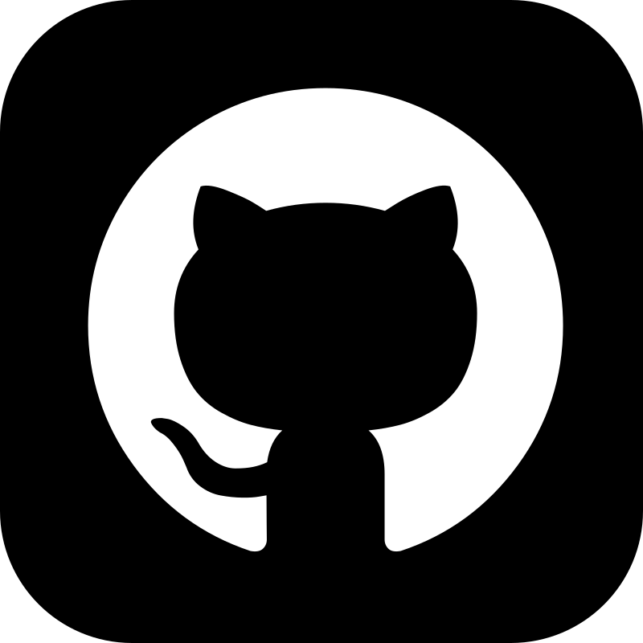

# 👋 Hi, I'm @North-Abyss (Yuvanesh KS)

  <b>Software Engineer | Cloud & Linux Infrastructure | Cross-Platform App Dev</b> 
  <i>(B.Tech IT '27 @ AMCET • Anna University | Also known as NorthAbyss / YuvaneshKS)</i>

  
  
  
  
  
  

---

### 🚀 Proof of Work & Engineering Focus

I am a **Software Engineer** specializing in Linux infrastructure, cloud systems, and cross-platform application development. I don't just write syntax; I architect complete production environments—from virtualization kernels up to polished user interfaces.

* **🐧 Systems Administration & Infrastructure:** Managing Linux virtualization environments on **Arch** and **Rocky Linux** using **KVM/QEMU** hypervisors, **Docker** containerization, and Bash automation. Experienced in "Lakehouse" architectures using **Databricks**, **Apache Spark**, and **SQL**.
* **📱 Cross-Platform Mobile & Web (Flutter/Dart & Design Tokens):** Building responsive, offline-first applications with scalable state management. Author of **Abyss Chat** (published on Google Play Store with WebRTC, AES-GCM, and mDNS discovery) and **Universal UI Themes** (22 zero-dependency CSS token presets).
* **🧠 Machine Learning & Low-Latency Systems:** Engineering predictive systems with PyTorch exported to **ONNX Runtime** for high-efficiency CPU inference (~2.7ms latency in **SkyPrognos**), and exploring quantum machine learning architectures (**Q-Ternary-VQC**).
* **🎮 Game Engineering:** Crafting performant 2D action platformers in **Godot 4** and **Java**, focusing on custom physics pipelines, procedural generation, and deterministic mechanics.

---

### 🛠️ Tech Stack & Tools

**Frontend, UI & Mobile**

  
  
  
  
  

**Systems, Cloud & Infrastructure**

  
  
  
  
  
  
  
  

**Languages & Frameworks**

  
  
  
  
  
  
  

**Game Engines**

  

---

### ⚡ Daily Dose of Logic

  

---

### 🗂️ Production & Flagship Proof-of-Work

| Project | Domain | Architecture & Highlights |
| :--- | :---: | :--- |
| **<a href="https://play.google.com/store/apps/details?id=com.abyss.chat" target="_blank">Abyss Chat</a>** | 📱 **Mobile / P2P** | **Live on Google Play.** Cross-platform decentralized P2P messaging and video calling with WebRTC, PeerJS, mDNS LAN discovery, and AES-GCM encryption. |
| **<a href="https://github.com/North-Abyss/SkyPrognos" target="_blank">SkyPrognos</a>** · [Demo](https://skyprognos.streamlit.app/) | 🧠 **AI / Digital Twin** | Aviation fleet health & predictive maintenance platform predicting engine Remaining Useful Life (RUL) with ~11.9 RMSE. PyTorch models exported to ONNX (~2.7ms CPU inference) with interactive Streamlit Digital Twin command center. |
| **<a href="https://github.com/North-Abyss/ui-themes" target="_blank">Universal UI Themes</a>** · [Demo](https://north-abyss.github.io/ui-themes/) | 🎨 **Design System** | 22 production-ready, zero-dependency universal UI themes & design token presets (Material 3, Glassmorphism, Claymorphism, Tokyo Night) in 100% pure Vanilla CSS. |
| **<a href="https://github.com/North-Abyss/Trackify-Flutter" target="_blank">Trackify</a>** · [Web App](https://north-abyss.github.io/Trackify-Flutter/) | 📱 **Mobile & Web** | High-performance productivity tracker with Provider state management, persistent storage, and claymorphic UI across Web, Android, Linux. |
| **<a href="https://github.com/North-Abyss/Enterprise-Home-Lab" target="_blank">Enterprise Home Lab</a>** | 🐧 **SysAdmin & Linux** | Custom Linux virtualization environment (KVM/QEMU) on Rocky Linux & Arch with Docker containers and automated Bash health checks. |
| **<a href="https://github.com/North-Abyss/Q-Ternary-VQC" target="_blank">Q-Ternary-VQC</a>** | ⚛️ **Quantum ML** | 72-parameter variational quantum classifier using 3-level Qutrits (d=3) for tabular data compression, CSUM ring entanglement, and SHAP explainability. |
| **<a href="https://github.com/North-Abyss/wave-of-fate" target="_blank">Wave of Fate</a>** · [Itch.io](https://north-abyss.itch.io/) | 🎮 **Game Logic** | 2D Metroidvania action platformer with custom physics, procedural UI, and collision algorithms built natively in Godot 4 (GitHub Game Off 2025). |
| **<a href="https://github.com/North-Abyss/JAVA-30" target="_blank">JAVA-30</a>** | ☕ **DSA & Systems** | 30-Day intensive Java programming & placement DSA practice repository covering OOP paradigms, recursion, algorithm optimizations, and interview algorithms. |

---

### 💼 Open for Opportunities
Looking to deploy this engineering stack into high-growth product teams, early-stage startups, and systems infrastructure roles for **final-year software engineering internships (Class of 2027)**.

  <a href="mailto:yuvaneshkarunakaran@gmail.com"><b>📧 Get in touch: yuvaneshkarunakaran@gmail.com</b></a> · 
  <a href="https://north-abyss.github.io/Portfolio/"><b>🌐 Explore Full Portfolio</b></a>

---

  

